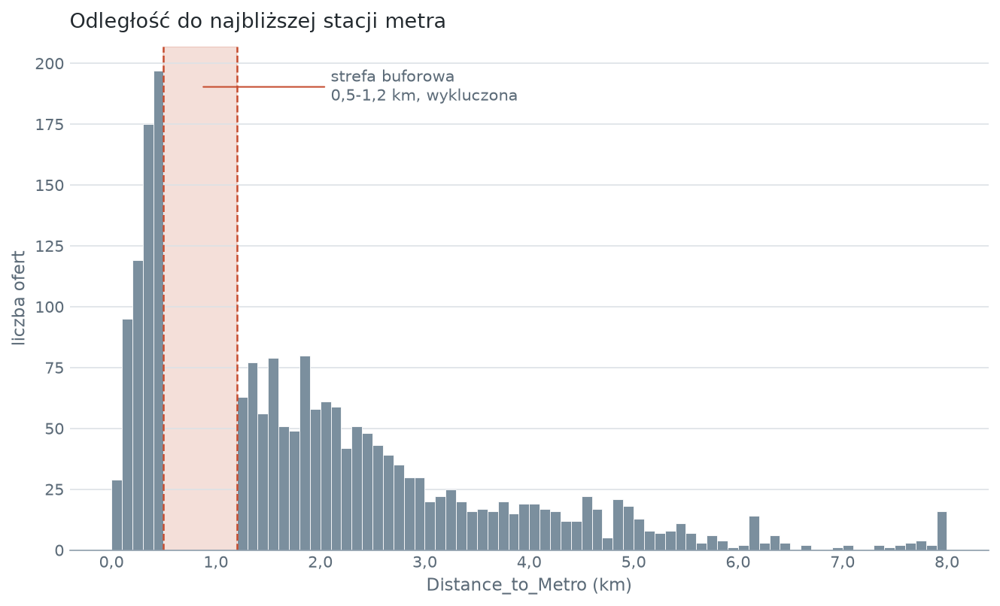
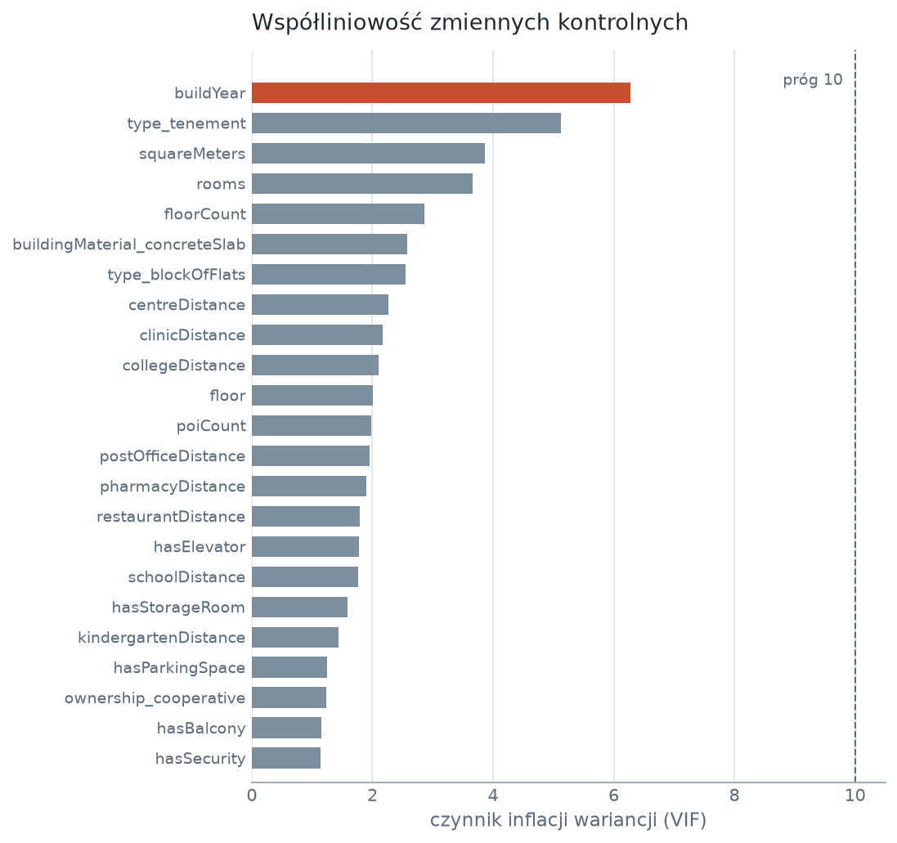
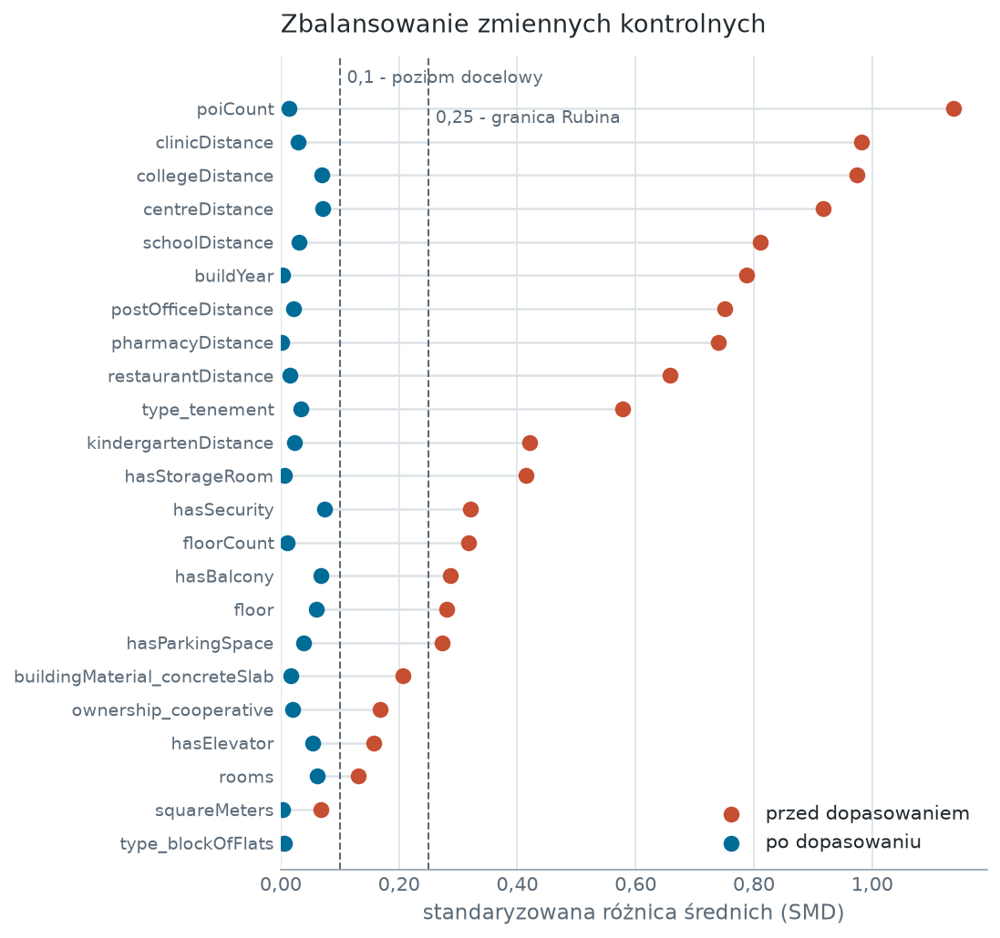
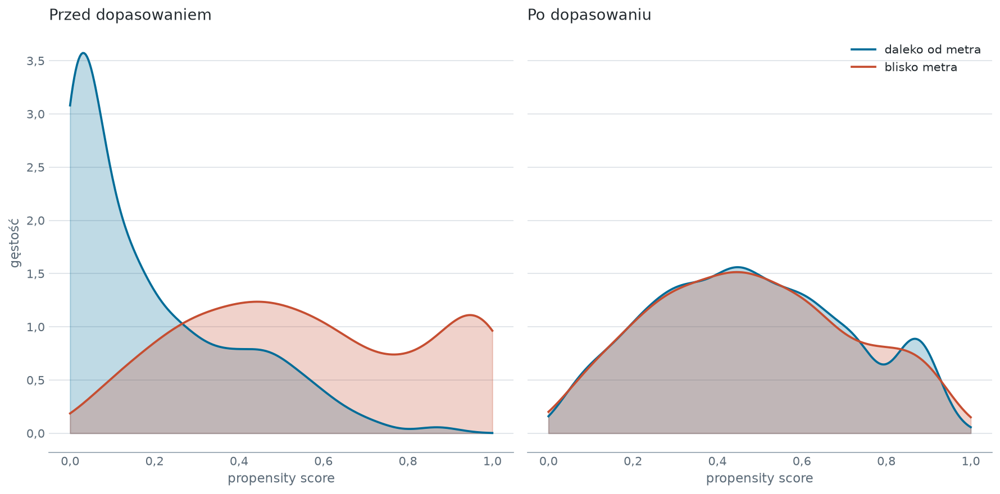
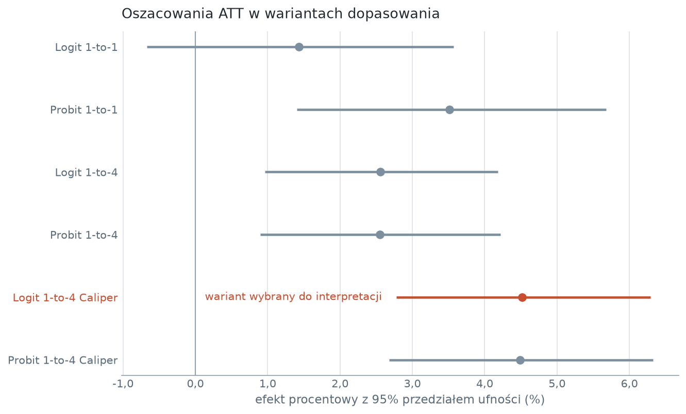
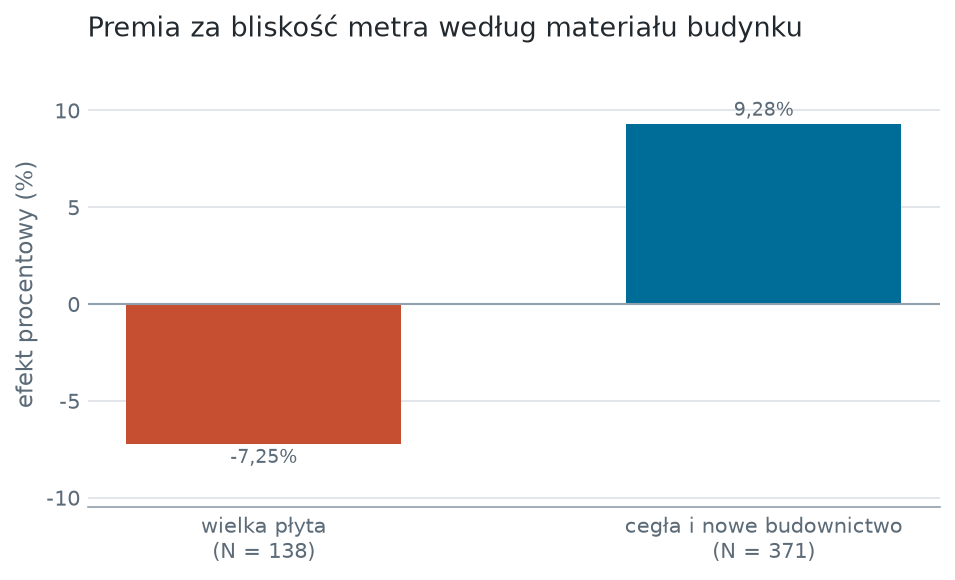

# Wpływ bliskości metra na ceny mieszkań w Warszawie

Mieszkania bliżej niż 0,5 km od stacji metra są droższe o 2366 zł/m2 od mieszkań oddalonych o ponad 1,2 km, ale po zestawieniu lokali o niemal identycznych cechach fizycznych premia za samo metro wynosi 735 zł/m2, czyli 4,52% ceny. Premia wyjaśnia 31,0% surowej różnicy; reszta wynika z innych cech skorelowanych z położeniem stacji. Główne ograniczenie wyniku jest w danych: usunięcie listowe braków zabiera 58,8% warszawskich ofert, a odpowiada za nie przede wszystkim `buildingMaterial`, czyli zmienna, na której stoi wniosek o zróżnicowaniu efektu.

## Pytanie badawcze

Czy bliskość stacji metra podnosi cenę mieszkania, czy też obserwowana różnica cen wynika z tego, że przy stacjach stoją inne mieszkania niż na obrzeżach. Problemem jest endogeniczność położenia: lokale przy metrze różnią się od pozostałych wiekiem budynku, technologią budowy i nasyceniem usług, więc proste porównanie średnich mierzy sumę tych różnic, nie wpływ samego metra.

Badanie przenosi na warszawski rynek mieszkaniowy podejście D'Elii, Conte Grand i Leóna (2020), którzy połączyli przestrzenne modele hedoniczne z Propensity Score Matching przy szacowaniu wpływu szybkiej komunikacji autobusowej na ceny nieruchomości w Buenos Aires.

## Dane

Oferty sprzedaży mieszkań z 15 polskich miast, zebrane z serwisów ogłoszeniowych i udostępnione na Kaggle przez Krzysztofa Jamroza jako `apartment-prices-in-poland`, na licencji Apache 2.0. Analiza korzysta z migawki 2024-06; plik `data/raw/apartments_pl_2024_06.csv` waży 3,9 MB i leży w repozytorium, więc projekt odtwarza się bez pobierania czegokolwiek.

Z 21 501 ofert w pliku 6962 dotyczy Warszawy. Zmienną wynikową jest `Price_per_m2`, czyli cena ofertowa podzielona przez powierzchnię. Do każdej oferty doliczana jest `Distance_to_Metro` - odległość euklidesowa do najbliższej z 38 stacji linii M1 i M2, liczona ze współrzędnych geograficznych.

Zmienną interwencyjną `Close_to_Metro` definiuje strefa buforowa: wartość 1 przypada lokalom bliżej niż 0,5 km od stacji, 0 - oddalonym o ponad 1,2 km, a przedział między progami wypada z próby. Przypisanie obserwacji z tego pasa do którejkolwiek grupy byłoby arbitralne, bo wpływ metra jest tam umiarkowany.



Po usunięciu listowym braków zostaje 2868 ofert, a po odrzuceniu strefy buforowej 2046: 615 w grupie eksperymentalnej i 1431 w kontrolnej. Zmiennych kontrolnych jest 23, w tym 14 ciągłych i dyskretnych, 5 zero-jedynkowych oraz `ownership_cooperative`, `buildingMaterial_concreteSlab`, `type_blockOfFlats` i `type_tenement`.

## Metody

Propensity score to prawdopodobieństwo warunkowe przynależności do grupy eksperymentalnej przy danym wektorze cech fizycznych lokalu. Położenie wobec stacji nie wchodzi do tego wektora, bo to ono jest przedmiotem szacowania.

Zmienne kontrolne są standaryzowane przed dopasowaniem, ponieważ algorytm najbliższego sąsiada liczy odległość euklidesową; bez tego powierzchnia i rok budowy zdominowałyby funkcję dystansu nad zmiennymi zero-jedynkowymi. Badanie przechodzi przez 6 wariantów: regresję logistyczną i probitową, dopasowanie 1-do-1 i 1-do-4 oraz wariant z ograniczeniem calipera.

Caliper ustawiono na 0,2 odchylenia standardowego samego propensity score, nie jego logitu; konwencja Austina (2011) zakłada logit, więc próg liczbowy nie jest z nią porównywalny. Ograniczenie odrzuca parę w całości, gdy najdalszy z przyjętych sąsiadów wypada poza limitem - to jego średnia wchodzi do różnicy parowej, więc sprawdzenie samego pierwszego sąsiada przepuściłoby pary z trzema obserwacjami dowolnie odległymi.

ATT jest średnią z różnic parowych między lokalem a jego sobowtórem, czyli średnią z dopasowanych sąsiadów. Istotność liczy test t-Studenta dla par, zgodny ze strukturą danych, a 95% przedział ufności pochodzi z tego samego błędu standardowego różnic parowych, więc oba wyniki opisują ten sam estymator. Analizę prowadzono równolegle na cenach nominalnych i ich logarytmach naturalnych; efekt procentowy wyznacza przekształcenie `(exp(ATT_log) - 1) * 100`.

Współliniowość sprawdzono czynnikiem inflacji wariancji na próbie modelowej. Najwyższa wartość wynosi 6,27 dla `buildYear`, żadna zmienna nie przekracza progu 10, więc estymacja propensity score nie opiera się na zmiennych wzajemnie się zastępujących.



## Zbalansowanie próby

Dopasowanie szacuje cokolwiek tylko wtedy, gdy po jego wykonaniu grupy przestają różnić się cechami fizycznymi. Miarą jest standaryzowana różnica średnich (SMD): licznik liczony jest na grupach dopasowanych, mianownik na pierwotnych. Stałe odniesienie w mianowniku jest tu konieczne, bo samo dopasowanie zmniejsza wariancję w próbie, a mianownik liczony po nim zawyżałby SMD i udawał pogorszenie balansu tam, gdzie zaszła poprawa (Stuart, 2010).

Przed dopasowaniem największa różnica dotyczy `poiCount` i wynosi 1,137 odchylenia standardowego. Po dopasowaniu najwyższy SMD wynosi 0,074 dla `hasSecurity`, a wszystkie 23 zmienne mieszczą się poniżej poziomu docelowego 0,1 przyjętego za Rubinem (2001).



Rozkłady propensity score w obu grupach, przed dopasowaniem rozłączne, po dopasowaniu niemal się pokrywają.



## Kluczowe wyniki

Do interpretacji wybrano wariant Logit 1-to-4 Caliper. Daje on ATT równe 735 zł/m2, czyli 4,52% przy 95% przedziale ufności [2,78%; 6,29%] i wartości p równej 3,53e-07. Premia wyjaśnia 31,0% surowej różnicy cenowej.

| Wariant | ATT (zł/m2) | ATT (%) | 95% CI (%) | p | Liczba par |
|---|---|---|---|---|---|
| Logit 1-to-1 | 183 | 1,43 | [-0,67; 3,57] | 0,183 | 615 |
| Probit 1-to-1 | 689 | 3,51 | [1,40; 5,68] | 0,001 | 615 |
| Logit 1-to-4 | 331 | 2,56 | [0,96; 4,18] | 0,002 | 615 |
| Probit 1-to-4 | 319 | 2,55 | [0,90; 4,22] | 0,002 | 615 |
| **Logit 1-to-4 Caliper** | **735** | **4,52** | **[2,78; 6,29]** | **<0,001** | **509** |
| Probit 1-to-4 Caliper | 717 | 4,49 | [2,68; 6,33] | <0,001 | 510 |

Oszacowanie bez calipera jest niższe we wszystkich czterech wariantach. Spadek liczby par z 615 do 509 oznacza, że dla 106 z 615 lokali przy metrze nie znalazł się dostatecznie podobny punkt odniesienia.



Wynik rozstrzyga, o ile droższe są mieszkania przy metrze po uwzględnieniu różnic w 23 zmiennych kontrolnych. Nie rozstrzyga natomiast, czy premia jest skutkiem budowy metra - dane obejmują jeden miesiąc, więc nie ma w nich zmienności w czasie, z której dałoby się wnioskować o kierunku zależności.

### Efekt zmienia znak zależnie od technologii budowy

W budownictwie ceglanym i nowych inwestycjach premia wynosi 9,28% przy 371 parach. W blokach z wielkiej płyty efekt jest ujemny i wynosi -7,25% przy 138 parach.



Jedna z możliwych interpretacji wiąże się ze specyfiką warszawskiego rynku: starsze osiedla przy stacjach pierwszej linii ustępują otoczeniem nowszym lokalizacjom oddalonym od węzłów komunikacyjnych, a w tańszym segmencie hałas i ograniczona liczba miejsc parkingowych mogą przeważać nad dogodnością dojazdu. Podział na podgrupy nie testuje jednak żadnej z tych przyczyn - rozkłada wyłącznie oszacowany efekt.

## Ograniczenia

- **Usunięcie listowe braków zabiera 58,8% warszawskich ofert**, z 6962 do 2868. Odpowiada za to głównie `buildingMaterial` z 43,36% braków, dalej `type` z 22,82%, `floor` z 14,45% i `buildYear` z 9,34%. Brak materiału budynku prawie na pewno nie jest losowy, a to właśnie ta zmienna dzieli próbę w analizie zróżnicowania efektu - wniosek o ujemnej premii w wielkiej płycie opiera się więc na podzbiorze ofert, które akurat ten atrybut podają. Ograniczenie zostaje: imputacja wymagałaby założenia o mechanizmie braków, którego dane nie pozwalają sprawdzić.
- **Dopasowanie odbywa się ze zwracaniem.** Ten sam lokal kontrolny trafia do wielu par, więc obserwacje w teście dla par nie są niezależne, a wartość p jest zaniżona. Kierunek i wielkość oszacowania punktowego pozostają bez zmian.
- **Caliper liczony jest w odchyleniach standardowych propensity score, nie jego logitu.** Konwencja Austina (2011) zakłada logit, więc wartości 0,2 nie należy porównywać z progami podawanymi w tamtej postaci.
- **Odległość jest euklidesowa.** Dla lokalu po drugiej stronie torów, rzeki albo trasy szybkiego ruchu rzeczywista droga dojścia jest dłuższa niż policzona, co przesuwa część obserwacji do niewłaściwej grupy.
- **Cena jest ofertowa, nie transakcyjna.** Wynik opisuje premię żądaną przez sprzedających, a nie zrealizowaną na rynku.
- **Jedno miasto i jeden miesiąc.** Wniosek dotyczy Warszawy w okresie 2024-06 i nie przenosi się automatycznie na inne miasta ani na inny stan rynku.

## Struktura projektu

```
psm-metro-warszawa/
├── data/raw/apartments_pl_2024_06.csv   oferty sprzedazy, jedyne wejscie
├── notebooks/
│   └── 01_psm_metro.ipynb               sterownik: wywoluje src/, zapisuje outputs/
├── src/
│   ├── config.py                        sciezki, parametry, wspolrzedne stacji
│   ├── data_load.py                     wczytanie, odleglosc do metra, strefa buforowa
│   ├── psm.py                           propensity score, dopasowanie, ATT, istotnosc
│   ├── balance.py                       standaryzowana roznica srednich
│   ├── diagnostics.py                   VIF i macierz korelacji
│   ├── viz.py                           rysunki
│   └── plot_style.py                    paleta i proporcje, jedyne zrodlo barw
├── outputs/figures/                     siedem rysunkow osadzonych wyzej
├── outputs/tables/                      licznosci, braki, warianty, SMD, podgrupy, VIF
└── tests/test_methodology.py            gwarancje metodologiczne
```

Notebook jest jedynym wejściem do obliczeń. Logika liczbowa mieszka w `src/`, komórki tylko ją wywołują.

## Uruchomienie

```bash
python -m venv venv
```

```bash
venv\Scripts\pip install -r requirements.txt
```

Następnie otwórz `notebooks/01_psm_metro.ipynb` i wykonaj wszystkie komórki od góry. Pełny przebieg trwa około 10 sekund na zwykłym laptopie i zapisuje 7 rysunków do `outputs/figures/` oraz 6 tabel do `outputs/tables/`.

Estymacja jest deterministyczna: regresja logistyczna i probit nie przeszukują losowych punktów startowych, więc dwa przebiegi dają identyczne oszacowania i tę samą macierz dopasowań. Kod nie przyjmuje ziarna, bo nie ma czego ustalać.

## Testy

```bash
venv\Scripts\python -m pytest
```

10 testów pilnuje założeń, na których opiera się wniosek, a nie tego, czy kod się wykonuje: strefa buforowa wyklucza pas 0,5-1,2 km także na danych rzeczywistych, mianownik SMD pochodzi z grup pierwotnych, żadna zmienna nie przekracza granicy zbalansowania, liczba par zgadza się z macierzą indeksów i sumuje z odrzuconymi do liczebności grupy eksperymentalnej, caliper ogranicza najdalszego a nie najbliższego sąsiada, sobowtór uśredniany jest w obrębie pary, a efekt procentowy i przedział ufności wynikają z różnic parowych na logarytmach. Każdy sprawdzono mutacją kodu: po wprowadzeniu błędu, przed którym ma chronić, test zawodzi.
